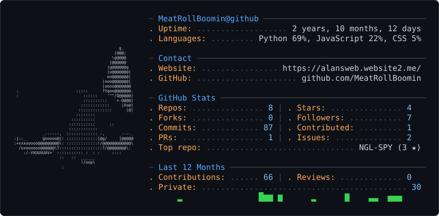
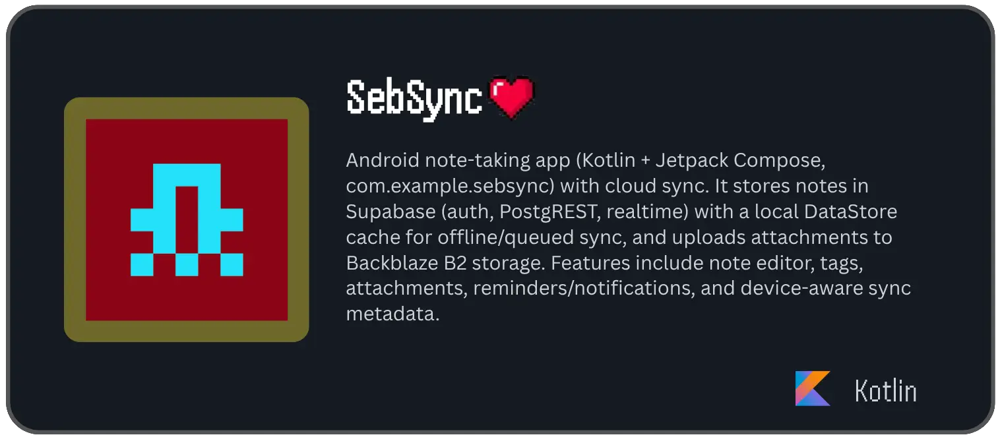
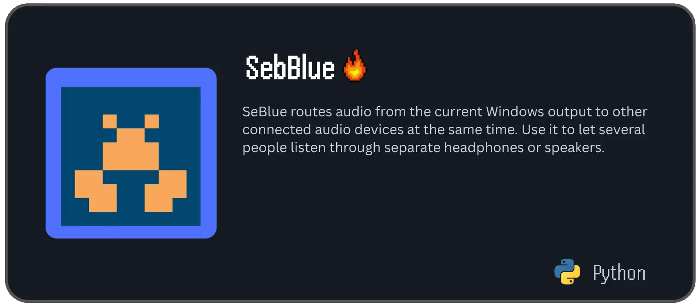
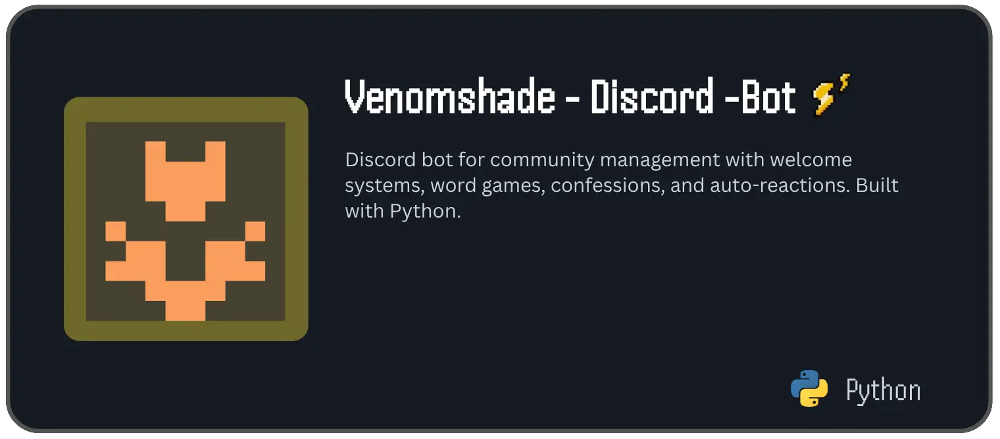
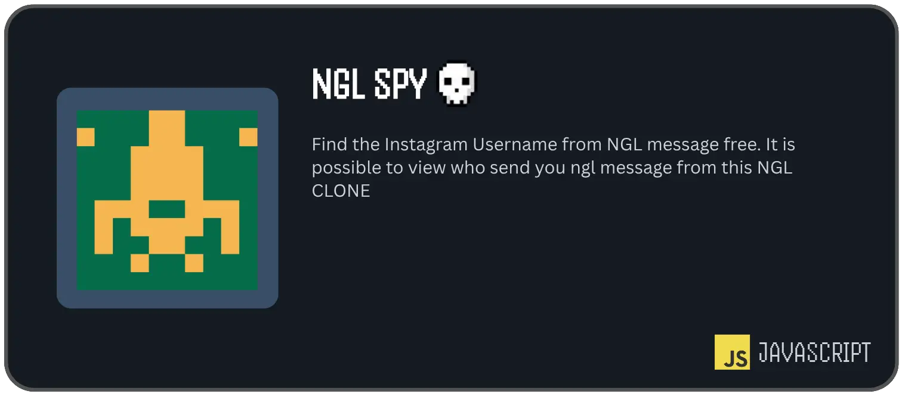

<picture>
  <source media="(prefers-color-scheme: dark)" srcset="images/dark_mode.svg" />
  <source media="(prefers-color-scheme: light)" srcset="images/light_mode.svg" />
  
</picture>

---
                                                      

<b>I like building software and learning how things work.</b>

 I work with Python, databases, and web and app technologies. This page is a quick look at what I'm working on.

 
___
Take a look at my latest work, including:

  
  
   
  
  

<picture>
  <source media="(prefers-color-scheme: dark)" srcset="https://raw.githubusercontent.com/CyberSecSleuth /CyberSecSleuth/output/github-snake-dark.svg" />
  <source media="(prefers-color-scheme: light)" srcset="https://raw.githubusercontent.com/CyberSecSleuth/CyberSecSleuth/output/github-snake.svg" />
  
</picture>

</ul>
 

___
<!--   -->

 